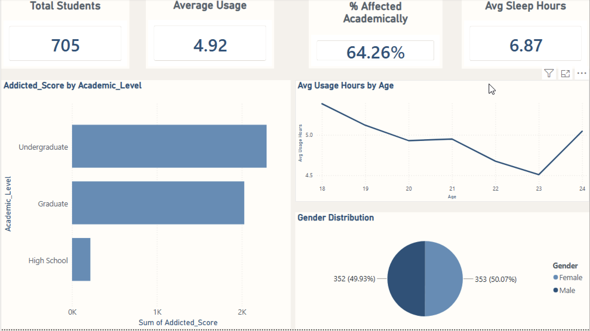
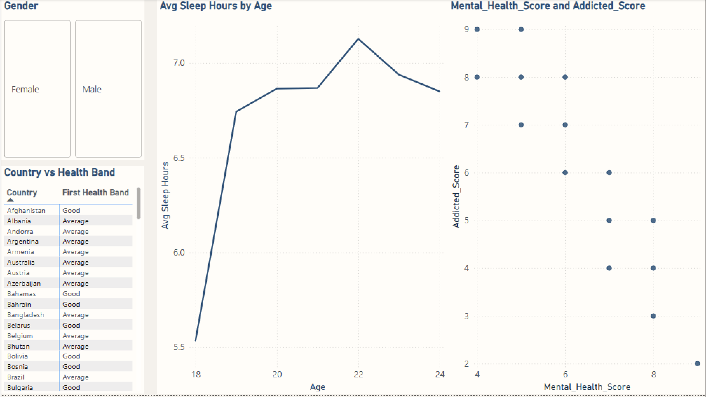
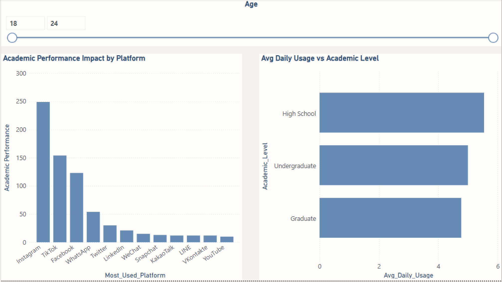
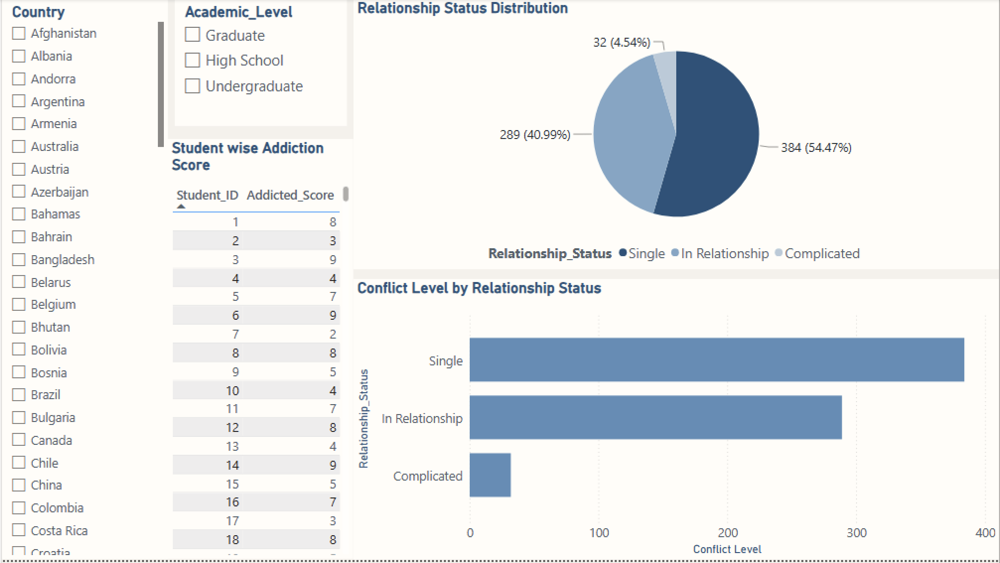
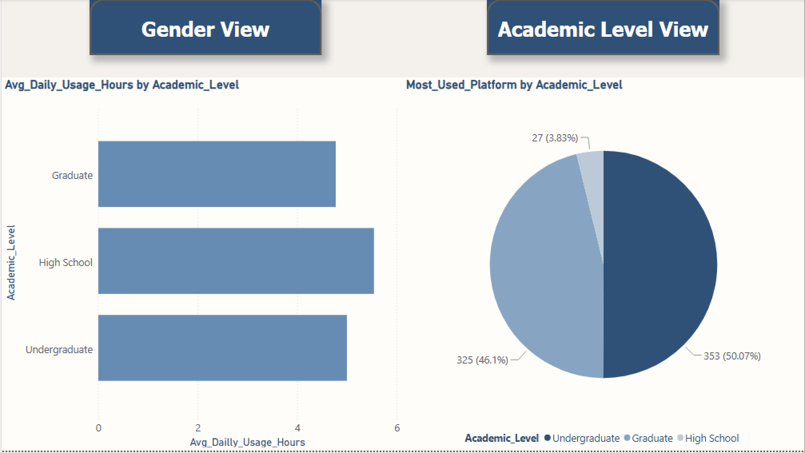
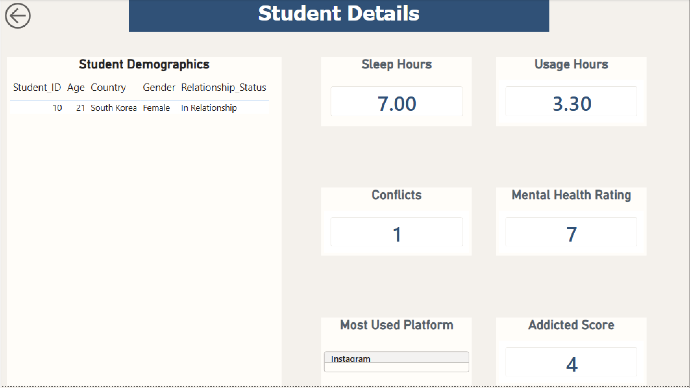

# 🎓 Students Social Media Addiction Analysis | Power BI

An interactive **Power BI data analytics project** focused on understanding student wellbeing, lifestyle patterns, academic impact, platform usage, and interpersonal relationships.

The dashboard transforms student-level data into interactive visual insights that help explore patterns between **mental health, lifestyle, academic outcomes, technology/platform usage, and social relationships**.

---

## 📊 Project Overview

This project was developed using **Microsoft Power BI** to demonstrate an end-to-end business intelligence and data visualization workflow.

### Dashboard Pages

1. **Executive Overview**
2. **Mental Health & Lifestyle**
3. **Academic Impact**
4. **Relationships and Conflicts**
5. **Interactive Story View**
6. **Drill-through Page**

The report includes interactive filters, slicers, navigation buttons, and drill-through functionality.

---

## 🎯 Project Objectives

- Analyze the overall student population and demographic information
- Understand mental health and lifestyle patterns
- Investigate factors affecting academic outcomes
- Analyze relationships and interpersonal conflicts
- Explore student platform usage
- Identify patterns within student-level data
- Build an interactive Power BI dashboard
- Practice data modeling, visualization, filtering, and drill-through

---

## 🛠️ Tools & Technologies

| Tool | Purpose |
|---|---|
| **Power BI Desktop** | Dashboard development and visualization |
| **Power Query** | Data transformation and preparation |
| **DAX** | Calculations and analytical logic |
| **Data Modeling** | Organizing and connecting datasets |
| **GitLab** | Version control and portfolio hosting |

---

# 📌 Dashboard Sections

## 1. Executive Overview

Provides a high-level summary of the student dataset.

### Key Elements

- Total Students
- KPI cards
- Student distribution by category
- Platform-related analysis
- Overall trends
- Interactive visual breakdowns

### Visualizations

- KPI Cards
- Bar Charts
- Line Charts
- Pie / Donut Charts

---

## 2. Mental Health & Lifestyle

Focuses on relationships between student lifestyle and mental wellbeing.

### Analysis Includes

- Lifestyle patterns
- Mental health indicators
- Student-level comparisons
- Relationship between selected lifestyle and wellbeing variables

### Visualizations

- Matrix
- Scatter Plot
- Line Chart
- Interactive Slicers

---

## 3. Academic Impact

Investigates factors associated with students' academic outcomes.

### Analysis Includes

- Academic-related indicators
- Student category comparisons
- Interactive filtering
- Patterns associated with academic performance

### Visualizations

- Bar Charts
- Column Charts
- Slicers

---

## 4. Relationships and Conflicts

Analyzes interpersonal relationships and conflict-related information.

### Visualizations

- Bar Charts
- Tables
- Pie / Donut Charts
- Interactive Slicers

This section combines high-level categorical analysis with detailed student information.

---

## 5. Interactive Story View

Provides a more guided way to explore important findings from the dataset.

### Features

- Interactive navigation
- Bar Charts
- Donut / Pie Charts
- Navigation and Action Buttons

This page demonstrates how Power BI can be used to create a presentation-friendly analytical experience.

---

## 6. Drill-through Page

Provides a detailed student-level view.

Users can select a relevant student or data point from another report page and navigate to the detailed drill-through page.

### Features

- Student-level KPI cards
- Detailed student information
- Drill-through functionality
- Back navigation
- Detailed table
- Context-sensitive analysis

---

# 🔄 Power BI Workflow

```text
Raw Data
   ↓
Power Query
   ↓
Data Cleaning & Transformation
   ↓
Data Model
   ↓
DAX / Calculations
   ↓
Visualizations
   ↓
Interactive Dashboard
   ↓
Insights
```

---

# 🧹 Data Preparation

Power Query was used as part of the data preparation workflow.

The preparation process includes:

- Reviewing data types
- Cleaning and transforming fields
- Preparing data for analysis
- Structuring tables for reporting
- Creating a usable analytical model

The **Applied Steps** section in Power Query provides a transparent transformation workflow.

---

# 📐 Data Modeling

The report uses multiple tables, including:

- `Student Details`
- `Platform Details`

The model allows information from these tables to be analyzed together through Power BI visuals and interactive filters.

---

# 📊 Power BI Features Demonstrated

### Power Query

- Data transformation
- Data type handling
- Data preparation
- Applied transformation steps

### Data Modeling

- Multiple-table data model
- Relationships between datasets
- Analytical attributes

### Visualization

- KPI Cards
- Bar Charts
- Column Charts
- Line Charts
- Pie Charts
- Donut Charts
- Scatter Plots
- Tables
- Matrix / Pivot Tables

### Interactivity

- Slicers
- Filters
- Cross-filtering
- Drill-through
- Navigation buttons
- Interactive report pages

---

# 💡 Key Analytical Questions

The dashboard is designed to answer questions such as:

- How many students are represented in the dataset?
- What patterns can be observed in student wellbeing?
- How do lifestyle factors relate to mental health indicators?
- What factors appear to be associated with academic outcomes?
- What patterns exist in student relationships and conflicts?
- How does platform usage vary across students?
- How can individual student records be investigated?
- What insights can be obtained by filtering the dashboard by different categories?

---

# 📈 Skills Demonstrated

- Power BI
- Power Query
- Data Cleaning
- Data Transformation
- Data Modeling
- DAX
- Data Visualization
- Dashboard Design
- Interactive Reporting
- Slicers & Filters
- Drill-through Analysis
- KPI Development
- Analytical Storytelling
- Data-driven Insights

---

# 🗂️ Recommended Repository Structure

```text
Students Social Media Addiction-PowerBI/
│
├── README.md
│
├── PowerBI/
│   └── Avinash_mini_project-PowerBI.pbix
│
├── Dataset/
│   └── dataset.csv
│
├── Screenshots/
│   ├── executive-overview.png
│   ├── mental-health-lifestyle.png
│   ├── academic-impact.png
│   ├── relationships-conflicts.png
│   ├── interactive-story.png
│   └── drill-through.png
│
└── Documentation/
    └── project-notes.md
```

---

# 🚀 How to Use

### 1. Clone the Repository

```bash
git clone <your-gitlab-repository-url>
```

### 2. Open the Power BI File

Open:

```text
PowerBI/Avinash_mini_project-PowerBI.pbix
```

using **Microsoft Power BI Desktop**.

### 3. Explore the Dashboard

Navigate through the report pages and use the available slicers, filters, buttons, and drill-through functionality.

---

# 📷 Dashboard Preview

### Executive Overview


### Mental Health & Lifestyle


### Academic Impact


### Relationships & Conflicts


### Interactive Story View


### Drill-through Page


---

# 🎓 Portfolio Value

This project demonstrates the ability to build a complete **interactive Power BI reporting solution**, rather than simply creating individual charts.

It showcases:

- Data preparation
- Data modeling
- Analytical thinking
- Dashboard development
- Interactive report design
- Multi-page reporting
- Drill-through analysis
- Data storytelling

The project is suitable for a **Data Analyst / BI Analyst portfolio**.

---

# 👨‍💻 Author

**Avinash Kumar**

Aspiring Data Analyst

---